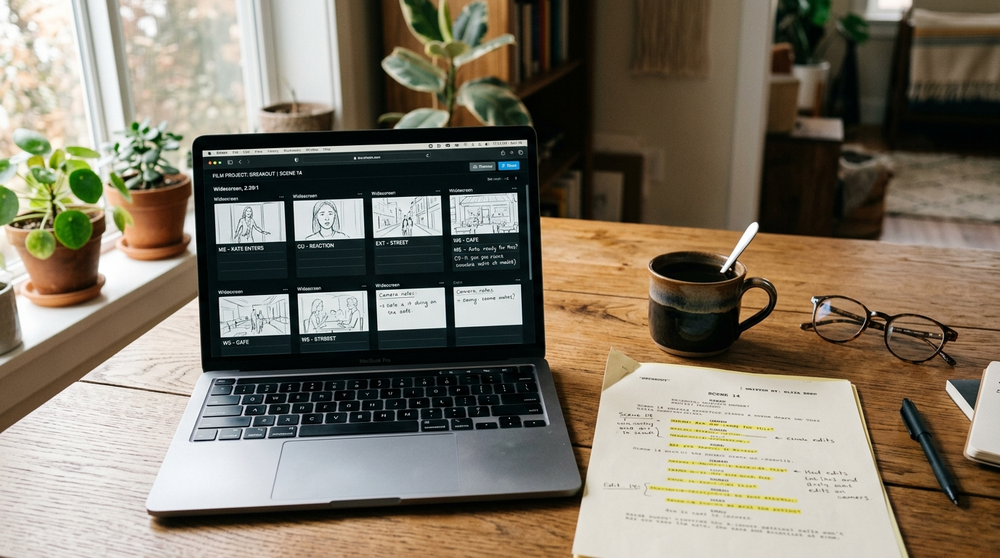
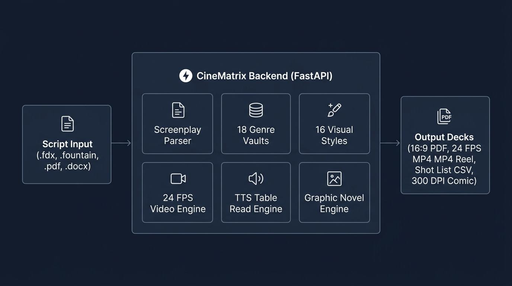
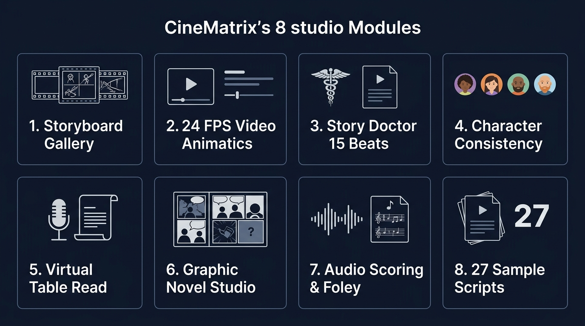

# CineMatrix — Screenplay Pre-Visualization & Directing Studio

<div align="center">



[](https://fastapi.tiangolo.com)
[](https://react.dev)
[](https://vitejs.dev)
[](https://opencv.org)
[](run_tests.bat)

<p align="center">
  <b>An open-source desktop studio for screenwriters, directors, and artists.</b><br/>
  <i>Convert standard screenplays into visual storyboards, 24 FPS animatics, structural beat sheets, and multi-voice table reads.</i>
</p>

[Quick Start](#-quick-start) • [Studio Modules](#-the-8-studio-modules) • [System Architecture](#-system-architecture) • [Sample Scripts](#-the-27-sample-script-library) • [Styles & Genres](#-styles--genre-presets) • [Testing](#-testing--verification)

</div>

---

## 📖 Overview

**CineMatrix** is a local-first pre-visualization and storytelling studio. It reads standard screenplays, stage plays, and literary documents across multiple formats (`.fdx`, `.fountain`, `.docx`, `.pdf`, `.epub`, `.cbz`), breaking scenes down into:

- **16:9 Storyboard Frames** with cinematography camera and lighting notes.
- **24 FPS Camera Motion Animatics** with camera moves (dolly, pan, handheld, slow-mo drift).
- **Blake Snyder 15-Beat Screenplay Coverage** with scene-by-scene narrative tension pacing.
- **Synchronized Virtual Table Reads** with multi-character teleprompter highlighting.
- **Graphic Novel & Comic Book Layouts** with geometric speech balloon placement and 300 DPI print export.
- **Procedural Cinematic Scoring & Foley** generating mood audio stems.
- **Production Export Decks** (16:9 PDF Keynote Decks, Shot List CSVs, ZIPs, Fountain, and Master MP4 Reels).

---

## 📐 System Architecture

CineMatrix is built with a FastAPI Python backend and a React/TypeScript frontend.

<div align="center">



</div>

### How It Works:
1. **Script Ingestion**: Ingests screenplay files and extracts scenes, headings, actions, character dialogue, and emotional tone.
2. **Analysis & Framing**: Evaluates scene intensity, recommends camera focal lengths, shot types, and lighting styles based on the genre.
3. **Visual & Motion Synthesis**: Synthesizes 16:9 visual frames and applies 24 FPS sub-pixel camera motion transforms locally via OpenCV.
4. **Export Engine**: Packages everything into PDF presentation decks, production shot lists, and stitched MP4 video reels.

---

## 🎬 The 8 Studio Modules

<div align="center">



</div>

### 1. Storyboard Gallery
- **Auto Image Generation**: Visual frames are generated and displayed during script analysis.
- **Camera & Lighting Specifications**: Clear, non-overlapping indicators for **Shot Type** (Close-up, Wide Shot, Over-the-Shoulder), **Camera Motion** (Dolly, Pan, Handheld), **Lens** (35mm Anamorphic, 50mm Prime), **Lighting**, and **Director's Notes**.
- **Batch Actions**: One-click actions to render all frames or animate all scenes.
- **Lightbox**: Fullscreen image inspection for examining shot details.

### 2. 24 FPS Video Animatics
- **Local Motion Engine**: Uses OpenCV to create smooth 24 FPS video clips (`.mp4`) directly on your machine.
- **6 Camera Presets**: *Dolly In*, *Dolly Out*, *Pan Left*, *Pan Right*, *Handheld Shake*, and *Slow-Mo Drift*.
- **Master Reel Compiler**: Stitches all scene animatics into a single master video reel.

### 3. Story Doctor (15-Beat Sheet)
- **Beat Classification**: Maps scenes against Blake Snyder's 15 story milestones (*Opening Image, Catalyst, Break into Two, Midpoint, All is Lost, Climax, Final Image*).
- **Tension Curve**: Visual graph tracking narrative pacing and dramatic intensity across acts.
- **Coverage Summary**: Summary breakdown of logline, act summaries, and pacing observations.

### 4. Character Consistency Library
- **Character Taxonomy**: Profiles characters by archetype, visual traits, and wardrobe.
- **Prompt Injection**: Automatically maintains character appearance details across generated frames.
- **Model Sheets**: Prompts for 4-angle character turnarounds and 6-expression facial matrices.

### 5. Virtual Table Read
- **Synchronized Teleprompter**: Auto-scrolling prompter that tracks dialogue line by line.
- **Voice Profiles**: Audition dialogue lines across 6 text-to-speech voice profiles.
- **Natural Cadence**: Speech timing model with realistic conversational pauses.

### 6. Graphic Novel Studio
- **Panel Layouts**: Supports 1-Splash, 2-Cinematic, 3-Strip, 4-Quadrant, 6-Grid Manga, 9-Panel, and Webtoon scroll layouts.
- **Balloon Placement**: Dynamic speech balloon and caption box positioning.
- **Print Ready**: Exports 300 DPI CMYK-ready print PDF files and `.cbz` comic packages.

### 7. Audio Scoring & Foley
- **Procedural Synthesizer**: Generates 16-bit 44.1kHz stereo audio stems for background atmosphere.
- **Mood Presets**: *Cinematic Epic*, *Noir Melancholy*, *Synthwave*, *Orchestral Drama*, *Horror Drone*, *Tactical Action*.
- **Foley SFX**: Ambient generators for thunderstorm, footsteps, gunshots, and dramatic impacts.

### 8. Master Export Suite
- **16:9 PDF Deck**: Presentation slide deck with camera framing and director notes.
- **Shot List CSV**: Direct export for production planning and shot tracking.
- **Full ZIP Archive**: High-resolution image package with manifest.
- **Fountain Screenplay**: Industry-standard script export.

---

## 📚 The 27 Sample Script Library

CineMatrix includes **27 sample screenplays** in [`docs/examples/`](docs/examples/), accessible in the **Example Scripts Hub** in the UI.

| Category | Scripts Included | Formats / Topics Covered |
|---|---|---|
| **Universal Formats** (9) | 01–09 | `.fdx` (Final Draft), `.fountain`, `.docx`, `.pdf`, `.cbz`, `.cbr`, `.epub`, `.txt`, Sitcom teleplay |
| **Engine Showcases** (6) | 10–15 | 15-Beat Sheet, Multi-Voice Table Read, Chase Animatic, Manga Layouts, Audio Score, Character Look-Book |
| **Genres & Styles** (9) | 16–24 | Cyberpunk Neo-Noir, Historical Drama, Psychological Horror, Action, Comedy, Romance, Doc, Anime, Western |
| **Duration Tiers** (3) | 25–27 | 1-Minute Micro Scene, 5-Minute Short Film, 15-Minute Feature Act One |

---

## 🎨 Styles & Genre Presets

### 16 Visual Art Styles
- **Oscar Prestige**: 35mm film grain, subtle halation, natural color balance.
- **Cyberpunk Neo-Noir**: Teal/magenta palette, anamorphic flares, rain-slicked asphalt.
- **Nordic Noir**: Desaturated overcast tones, muted natural lighting.
- **Vintage Noir**: Deep chiaroscuro black & white, venetian blind key lights.
- **Anime Cinematic**: Painterly watercolor backgrounds, vibrant skies.
- **Classic Graphic Novel**: High-contrast inks, bold cross-hatching.
- **Hyper-Realistic**: Sharp photographic film texture, shallow depth-of-field.
- **Manga Kinetic**: Action speed lines, screentone shading.
- *Also includes: Watercolor Storyboard, Retro 70s, Grimdark Fantasy, Pastel Romance, Modern Blockbuster, Silent Expressionist, Concept Art Matte, and Architectural Blueprint.*

---

## 🚀 Quick Start

### Requirements
- **Python 3.10+**
- **Node.js 18+** & **npm**
- **Git**

### 1-Click Desktop Launch (Windows)
Double-click [`start_storyboard.bat`](start_storyboard.bat) or run in PowerShell:
```powershell
./start_storyboard.ps1
```
This launches the FastAPI backend on `http://127.0.0.1:8000`, starts the Vite frontend on `http://localhost:5173`, and opens your default browser.

### Manual Launch

**Backend:**
```bash
cd backend
python -m pip install -r requirements.txt
python main.py
```

**Frontend:**
```bash
cd frontend
npm install
npm run dev
```

---

## 🧪 Testing & Verification

Run the test suite:
```bash
run_tests.bat
```

Or run directly:
```bash
# Run backend test suite (104 tests)
python -m pytest backend/tests/ -v

# Validate frontend production build
cd frontend && npm run build
```

---

## 📄 License & Credits

Created by **Kirk LaSalle**. All rights reserved.
Built for screenwriters, filmmakers, animators, and visual storytellers.
